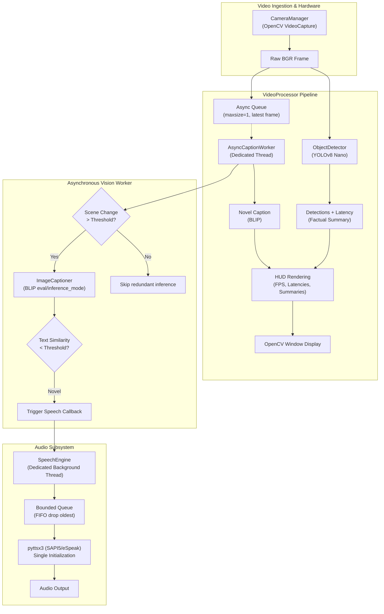

# AI-Powered Real-Time Visual Assistance System

An asynchronous, modular, and resilient computer vision assistance pipeline combining real-time object detection (**YOLOv8**), natural language image captioning (**Salesforce BLIP**), and auditory feedback (**pyttsx3**).

> [!WARNING]
> **Assistive Tool Disclaimer**  
> This application is intended strictly as an assistive research and visual augmentation tool. It **must not** be relied upon as the sole source of navigation, medical decision-making, or safety-critical awareness in hazardous or unpredictable environments.

---

## Architecture Overview



---

## Key Features

- **Non-Blocking Asynchronous Captioning**: Heavy BLIP transformer inference (~850ms on CPU) is isolated in a dedicated background worker with single-slot latest-frame queuing. Video preview and YOLO detection run continuously without freezing or frame drops.
- **Scene-Change & Redundancy Filtering**: Compares downsampled normalized frame differences and text similarity ratios to skip redundant inference when the scene is static.
- **Factual Detection-Aware Summaries**: Aggregates verified YOLO object labels with BLIP captions without hallucinating unsupported visual details.
- **Resilient Audio Pipeline**: Reuses a single initialized `pyttsx3` engine inside a dedicated thread, protecting against COM deadlocks, unbounded queue latency, and speech repetition.
- **Centralized & Validated Configuration**: Configurable via command-line arguments, JSON config files, or dataclass models with automatic path resolution.
- **Live Performance HUD**: Displays real-time camera FPS, detection latency (ms), BLIP latency (ms), end-to-end latency (ms), active compute device, and speech state.

---

## Directory Structure

```
real_time_object_captioning/
├── src/
│   ├── main.py                     # Main CLI application entry point
│   ├── config.py                   # Centralized configuration & argument parsing
│   ├── real_time_assist.py         # Backwards-compatible legacy entry point
│   ├── object_detection.py         # Standalone YOLO detection script
│   ├── captioning.py               # Standalone BLIP testing script
│   ├── test_camera.py              # Camera stream verification utility
│   ├── list_cameras.py             # Available camera device scanner
│   ├── vision/
│   │   ├── detector.py             # YOLOv8 object detector with evaluation mode
│   │   ├── captioner.py            # Asynchronous BLIP captioner with deduplication
│   │   └── tracker.py              # Lightweight centroid and object tracking
│   ├── audio/
│   │   └── speech_engine.py        # Dedicated non-blocking pyttsx3 speech worker
│   ├── pipeline/
│   │   └── video_processor.py      # Master video orchestration & HUD rendering
│   └── utils/
│       └── camera.py               # OpenCV camera manager with reconnection
├── tests/                          # Automated unit and integration test suite
├── models/
│   └── yolov8n.pt                  # YOLOv8 nano pre-trained weights
├── assets/                         # Benchmark & test images
├── requirements.txt
└── README.md
```

---

## Installation & Setup

### 1. Clone the Repository
```bash
git clone https://github.com/Shahid-2705/real_time_object_captioning.git
cd real_time_object_captioning
```

### 2. Virtual Environment Setup
```bash
# Windows
python -m venv .venv
.venv\Scripts\activate

# Linux / macOS
python3 -m venv .venv
source .venv/bin/activate
```

### 3. Install Dependencies

**For CPU-only systems:**
```bash
pip install -r requirements.txt
```

**For NVIDIA CUDA systems:**
```bash
pip install torch torchvision --index-url https://download.pytorch.org/whl/cu124
pip install -r requirements.txt
```

---

## Execution & Usage

### 1. Run the Full Visual Assistant
```bash
python src/main.py
```
*(or run the legacy entry point `python src/real_time_assist.py`)*

### 2. Useful Command-Line Options
```bash
# Run with a specific camera index (e.g. index 1)
python src/main.py --camera-index 1

# Run with custom resolution and faster speech rate
python src/main.py --resolution 640x480 --speech-rate 180

# Run in silent mode (HUD only, speech disabled)
python src/main.py --no-speech

# Force execution on CPU even if CUDA is present
python src/main.py --device cpu

# Enable object tracking across frames
python src/main.py --enable-tracking

# Enable verbose debug logging
python src/main.py --debug
```

### 3. Interactive Keyboard Controls
| Key | Action |
|:---:|:---|
| `Q` / `ESC` | Exit application cleanly |
| `S` | Toggle voice speech ON / OFF |
| `C` | Force immediate caption generation on current frame |
| `T` | Toggle YOLO object tracking |

---

## Configuration Reference

| Option | Type | Default | Description |
|:---|:---:|:---:|:---|
| `--camera-index` | `int` | `0` | Camera device index |
| `--resolution` | `str` | `640x480` | Frame dimensions (`WIDTHxHEIGHT`) |
| `--confidence` | `float` | `0.35` | Minimum YOLO detection confidence (0.0-1.0) |
| `--caption-interval` | `float` | `3.0` | Minimum seconds between BLIP caption cycles |
| `--min-speech-interval`| `float` | `3.0` | Minimum cooldown between spoken announcements |
| `--speech-rate` | `int` | `160` | TTS words per minute |
| `--speech-volume` | `float` | `1.0` | Audio volume (0.0 - 1.0) |
| `--no-speech` | flag | `False` | Disable audio speech output |
| `--enable-tracking` | flag | `False` | Enable persistent object tracking |
| `--device` | `str` | `auto` | Target device (`auto`, `cuda`, `cpu`) |
| `--config` | `str` | `None` | Path to optional JSON configuration file |

---

## Measured Performance Benchmarks

*Hardware environment: Intel Core CPU (no discrete GPU detected), Python 3.13, PyTorch 2.9.0+cpu, OpenCV 4.12.0.*

| Pipeline Component | Measured Latency | Throughput | Implementation Mode |
|:---|:---:|:---:|:---|
| **YOLOv8n Object Detection** | **68.5 ms** | ~14.6 FPS | Synchronous `torch.inference_mode()` |
| **Salesforce BLIP Captioning** | **858.5 ms** | ~1.1 FPS | Asynchronous background worker |
| **Camera Acquisition & Display** | **< 2 ms** | 30.0 FPS | Native OpenCV VideoCapture |
| **End-to-End Display Latency** | **~71 ms** | Responsive | Non-blocking decoupling |

*Note: In the previous monolithic architecture, BLIP caused a ~860ms video stall every 30 frames. Under the upgraded asynchronous architecture, video display and camera capture run at full camera frame rate without interruption.*

---

## Automated Test Suite

All modules are covered by automated unit tests that do not require physical webcams or remote weight downloads:

```bash
python -m unittest discover -s tests -p "test_*.py"
```

**Results:**
```
Ran 21 tests in 0.961s
OK
```

---

## Known Limitations & Roadmap

### Limitations
- **CPU Inference Speed**: Generating captions on CPU requires ~850ms per novel frame. A dedicated GPU drops this to < 100ms.
- **Single Audio Stream**: Multiple simultaneous auditory alerts queue sequentially with FIFO drop-oldest logic.

### Roadmap
- [ ] Add TensorRT / ONNX Runtime export for YOLO and BLIP acceleration.
- [ ] Incorporate depth estimation (e.g., MiDaS) for proximity and obstacle distance warnings.
- [ ] Add spatial audio cues (left/right panning) corresponding to detected object locations.
